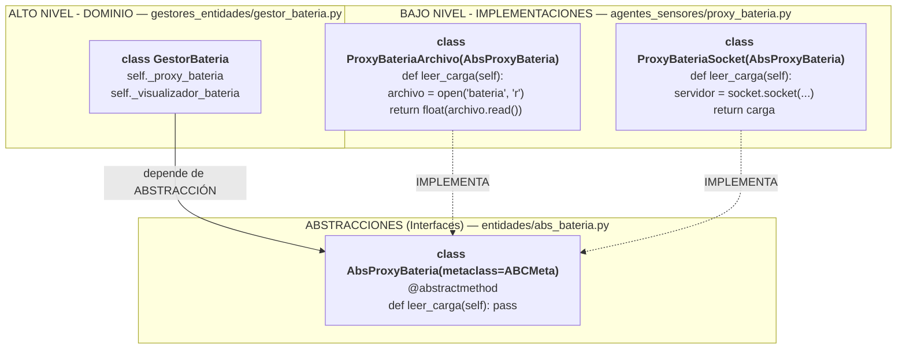
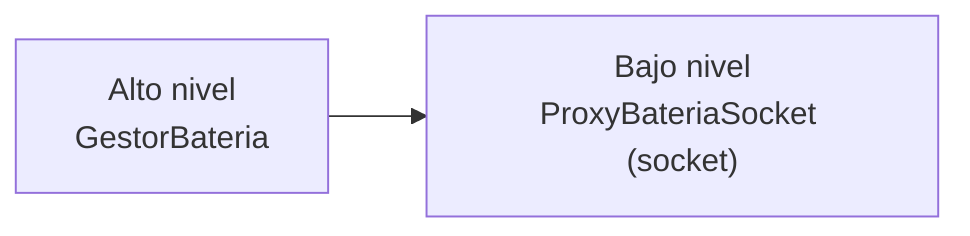
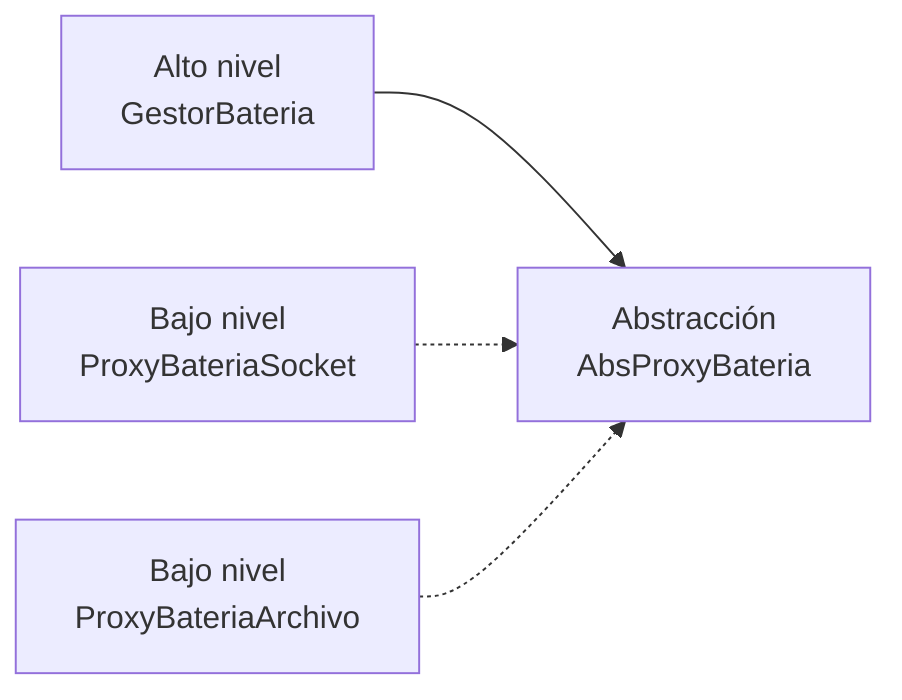
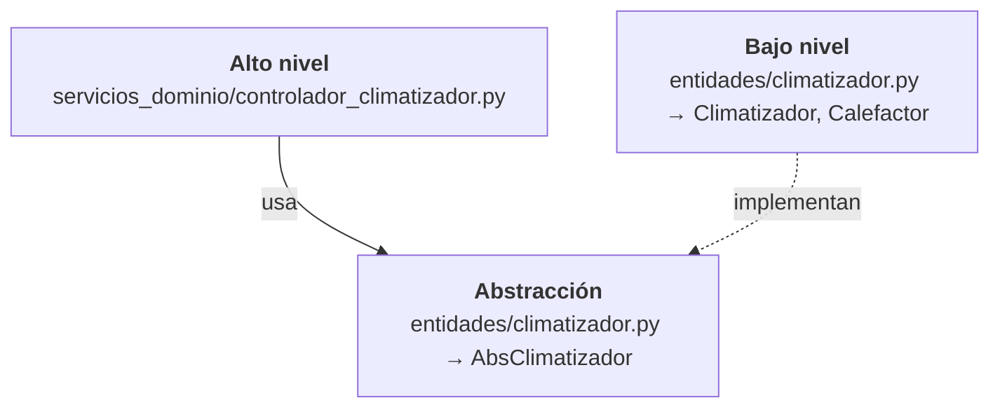
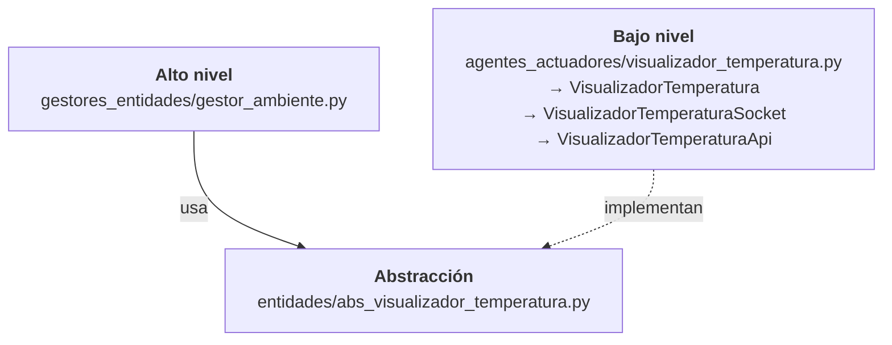

# Buenos Ejemplos de Principios SOLID en ISSE_Termostato

**Proyecto:** ISSE_Termostato
**Fecha:** Noviembre 2025
**Análisis realizado por:** Claude Code

---

## Índice

1. [Single Responsibility Principle (SRP)](#1-single-responsibility-principle-srp)
2. [Open/Closed Principle (OCP)](#2-openclosed-principle-ocp)
3. [Liskov Substitution Principle (LSP)](#3-liskov-substitution-principle-lsp)
4. [Interface Segregation Principle (ISP)](#4-interface-segregation-principle-isp)
5. [Dependency Inversion Principle (DIP)](#5-dependency-inversion-principle-dip)

---

## 1. Single Responsibility Principle (SRP)

> **"Una clase debe tener una, y solo una, razón para cambiar."**
> — Robert C. Martin

### ✅ Ejemplo Excelente: `OperadorParalelo`

**Archivo:** `servicios_aplicacion/operador_paralelo.py`

#### Análisis

Aunque el análisis de violaciones listó a `OperadorParalelo` como una violación crítica, **esto es incorrecto**. La orquestación paralela ES su responsabilidad única.

```python
class OperadorParalelo:

    def __init__(self, gestor_bateria, gestor_ambiente, gestor_climatizador):
        self._gestor_bateria = gestor_bateria
        self._gestor_ambiente = gestor_ambiente
        self._gestor_climatizador = gestor_climatizador
        self._selector = SelectorEntradaTemperatura(self._gestor_ambiente)
        self._presentador = Presentador(...)

    def ejecutar(self):
        # ✅ Responsabilidad única: "Orquestar la ejecución paralela
        #    de las tareas del termostato"
        t1 = threading.Thread(target=self.lee_carga_bateria)
        t2 = threading.Thread(target=self.lee_temperatura_ambiente)
        t3 = threading.Thread(target=self.acciona_climatizador)
        t4 = threading.Thread(target=self.muestra_parametros)
        t5 = threading.Thread(target=self.setea_temperatura)

        t1.start()
        t2.start()
        t3.start()
        t4.start()
        t5.start()
```

#### ¿Por qué cumple SRP?

**Responsabilidad única cohesiva:**
- Define QUÉ tareas se ejecutan en paralelo
- Crea los threads necesarios
- Inicia la ejecución concurrente
- Delega cada operación específica a los componentes especializados

Los métodos `lee_*()` y `acciona_*()` son simplemente **puntos de entrada para delegación**, no "responsabilidades separadas".

#### Problemas Reales (no violaciones de SRP)

El análisis confundió problemas de **diseño** con violaciones de **SRP**:

1. ❌ **Mezcla logging con lógica** (prints hardcodeados)
2. ❌ **Configuración hardcodeada** (intervalos con `time.sleep()`)
3. ❌ **Crea dependencias** (viola DIP, no SRP)
4. ❌ **Rompe encapsulación** (accede a `.ambiente`)

#### Conclusión

`OperadorParalelo` **NO viola SRP**. Su responsabilidad es clara: orquestar ejecución paralela. Los problemas están en otros principios (DIP, encapsulación), no en tener múltiples responsabilidades.

---

## 2. Open/Closed Principle (OCP)

> **"Las entidades de software deben estar abiertas para extensión, pero cerradas para modificación."**
> — Bertrand Meyer

### ✅ Ejemplo Excelente: Sistema de Visualizadores

**Archivos:**
- `entidades/abs_visualizador_temperatura.py` (Abstracción)
- `agentes_actuadores/visualizador_temperatura.py` (Implementaciones)
- `gestores_entidades/gestor_ambiente.py` (Cliente)

#### 1. La abstracción (cerrada para modificación)

```python
# entidades/abs_visualizador_temperatura.py
class AbsVisualizadorTemperatura(metaclass=ABCMeta):

    @staticmethod
    @abstractmethod
    def mostrar_temperatura_ambiente(temperatura_ambiente):
        pass

    @staticmethod
    @abstractmethod
    def mostrar_temperatura_deseada(temperatura_deseada):
        pass
```

#### 2. Las implementaciones (abierto para extensión)

```python
# agentes_actuadores/visualizador_temperatura.py

# Implementación 1: Consola
class VisualizadorTemperatura(AbsVisualizadorTemperatura):
    @staticmethod
    def mostrar_temperatura_ambiente(temperatura_ambiente):
        print(str(temperatura_ambiente))  # ✅ Muestra en consola

# Implementación 2: Socket
class VisualizadorTemperaturaSocket(AbsVisualizadorTemperatura):
    @staticmethod
    def mostrar_temperatura_ambiente(temperatura_ambiente):
        cliente = socket.socket(...)
        cliente.send(...)  # ✅ Envía por socket

# Implementación 3: API REST
class VisualizadorTemperaturaApi(AbsVisualizadorTemperatura):
    @staticmethod
    def mostrar_temperatura_ambiente(temperatura_ambiente):
        requests.post(api_url, json={...})  # ✅ Envía por HTTP
```

#### 3. El código cliente (NO necesita modificarse)

```python
# gestor_ambiente.py
class GestorAmbiente:

    def mostrar_temperatura_ambiente(self):
        # ✅ Usa la abstracción, NO la implementación concreta
        # ✅ Este código NUNCA cambia cuando agregas nuevos visualizadores
        self._visualizador_temperatura.mostrar_temperatura_ambiente(
            self._ambiente.temperatura_ambiente
        )
```

#### ¿Por qué cumple OCP?

**Cerrado para modificación:**
- `GestorAmbiente` NO necesita cambiar cuando agregas un nuevo visualizador
- El método `mostrar_temperatura_ambiente()` es estable

**Abierto para extensión:**
```python
# Agregar nuevo visualizador MQTT sin tocar código existente

# NUEVA implementación - archivo nuevo
class VisualizadorTemperaturaMQTT(AbsVisualizadorTemperatura):
    @staticmethod
    def mostrar_temperatura_ambiente(temperatura_ambiente):
        mqtt_client.publish("temperatura/ambiente", temperatura_ambiente)

# ✅ GestorAmbiente no necesita modificarse
# ✅ Solo configuras cuál usar en termostato.json
```

#### Otros Ejemplos Excelentes

1. **Sistema de Proxies de Sensores:**
   - `AbsProxySensorTemperatura` → `ProxySensorTemperaturaArchivo` / `ProxySensorTemperaturaSocket`
   - Puedes agregar `ProxySensorTemperaturaMQTT` sin cambios en el gestor

2. **Sistema de Climatizadores:**
   - `AbsClimatizador` → `Climatizador` / `Calefactor`
   - Puedes agregar `AireAcondicionado` sin modificar el gestor

3. **Sistema de Actuadores:**
   - `AbsActuadorClimatizador` → `ActuadorClimatizadorGeneral`
   - Puedes agregar `ActuadorClimatizadorRemoto` sin cambios

#### Conclusión

El diseño de abstracciones e implementaciones múltiples cumple **perfectamente el OCP**. El código cliente depende de interfaces estables, y nuevas funcionalidades se agregan creando nuevas clases, no modificando las existentes.

---

## 3. Liskov Substitution Principle (LSP)

> **"Los objetos de una clase derivada deben poder reemplazar objetos de la clase base sin alterar el comportamiento correcto del programa."**
> — Barbara Liskov

### ✅ Ejemplo Excelente: Sistema de Climatizadores

**Archivos:**
- `entidades/climatizador.py` (Abstracción e implementaciones)
- `gestores_entidades/gestor_climatizador.py` (Cliente)

#### 1. La abstracción (contrato claro)

```python
# entidades/climatizador.py
class AbsClimatizador(metaclass=ABCMeta):
    """Clase Abstracta Climatizador"""

    @property
    def estado(self):
        return self._estado

    def __init__(self):
        self._estado = "apagado"
        self._maquina_estado = []
        self._inicializar_maquina_estado()

    def proximo_estado(self, accion):
        # ✅ Implementación compartida - comportamiento común
        estado_actual = [self._estado, accion]
        for transicion in self._maquina_estado:
            if estado_actual == transicion[0]:
                self._estado = transicion[1]
                return self._estado
        raise 'No existe proximo estado'

    @abstractmethod
    def _inicializar_maquina_estado(self):
        pass

    @abstractmethod
    def evaluar_accion(self, ambiente):
        pass
```

#### 2. Implementación 1: Climatizador (calienta Y enfría)

```python
class Climatizador(AbsClimatizador):
    """Climatizador: calienta y enfria el ambiente"""

    def _inicializar_maquina_estado(self):
        # ✅ 4 transiciones: puede calentar y enfriar
        self._maquina_estado.append([["apagado", "calentar"], "calentando"])
        self._maquina_estado.append([["apagado", "enfriar"], "enfriando"])
        self._maquina_estado.append([["calentando", "apagar"], "apagado"])
        self._maquina_estado.append([["enfriando", "apagar"], "apagado"])

    def evaluar_accion(self, ambiente):
        # ✅ Misma signature, mismo tipo de retorno
        temperatura = ControladorTemperatura.comparar_temperatura(
            ambiente.temperatura_ambiente,
            ambiente.temperatura_deseada
        )
        accion = self._definir_accion(temperatura)
        return accion

    def _definir_accion(self, temperatura):
        # ✅ Lógica: puede enfriar O calentar
        accion = None
        if temperatura == "alta":
            if self._estado == "apagado":
                accion = "enfriar"
            elif self._estado == "calentando":
                accion = "apagar"
        if temperatura == "baja":
            if self._estado == "apagado":
                accion = "calentar"
            elif self._estado == "enfriando":
                accion = "apagar"
        return accion
```

#### 3. Implementación 2: Calefactor (solo calienta)

```python
class Calefactor(AbsClimatizador):
    """Calefactor: solo puede calentar"""

    def _inicializar_maquina_estado(self):
        # ✅ 3 transiciones: solo puede calentar, no enfriar
        self._maquina_estado.append([["apagado", "calentar"], "calentando"])
        self._maquina_estado.append([["apagado", "enfriar"], "apagado"])  # enfriar = nada
        self._maquina_estado.append([["calentando", "apagar"], "apagado"])

    def evaluar_accion(self, ambiente):
        # ✅ MISMA signature que Climatizador
        temperatura = ControladorTemperatura.comparar_temperatura(
            ambiente.temperatura_ambiente,
            ambiente.temperatura_deseada
        )
        accion = self._definir_accion(temperatura)
        return accion

    def _definir_accion(self, temperatura):
        # ✅ Lógica diferente pero comportamiento válido
        accion = None
        if temperatura == "baja":
            if self._estado == "apagado":
                accion = "calentar"
        else:
            if self._estado == "calentando":
                accion = "apagar"
        return accion
```

#### 4. El código cliente (completamente intercambiable)

```python
# gestor_climatizador.py
class GestorClimatizador:

    def accionar_climatizador(self, ambiente):
        # ✅ Este código funciona IGUAL con Climatizador o Calefactor
        accion = self._climatizador.evaluar_accion(ambiente)

        if accion:
            nuevo_estado = self._climatizador.proximo_estado(accion)
            self._actuador.accionar_climatizador(accion)
```

#### ¿Por qué cumple LSP?

**1. Signatures consistentes:**

| Método | Climatizador | Calefactor | ¿Intercambiable? |
|--------|--------------|------------|------------------|
| `__init__(self)` | ✅ | ✅ | ✅ Sí |
| `evaluar_accion(self, ambiente)` | ✅ | ✅ | ✅ Sí |
| `_definir_accion(self, temperatura)` | ✅ | ✅ | ✅ Sí |
| `proximo_estado(self, accion)` | ✅ Heredado | ✅ Heredado | ✅ Sí |

**NO hay cambios de `@staticmethod` a método de instancia.**

**2. Comportamiento consistente:**

```python
# Con Climatizador:
climatizador = Climatizador()
accion = climatizador.evaluar_accion(ambiente)
# ✅ Retorna: "enfriar" | "calentar" | "apagar" | None

# Con Calefactor:
calefactor = Calefactor()
accion = calefactor.evaluar_accion(ambiente)
# ✅ Retorna: "calentar" | "apagar" | None
# ✅ NUNCA retorna "enfriar", pero retorna None (válido)
```

**3. Test de intercambiabilidad:**

```python
def test_cualquier_climatizador_funciona(climatizador: AbsClimatizador):
    """Este test debe pasar con CUALQUIER implementación"""
    ambiente = Ambiente(temperatura_deseada_inicial=20)
    ambiente.temperatura_ambiente = 25

    # ✅ Ambos pueden evaluar
    accion = climatizador.evaluar_accion(ambiente)

    # ✅ Ambos retornan string o None
    assert accion is None or isinstance(accion, str)

    # ✅ Si hay acción, ambos pueden cambiar estado
    if accion:
        nuevo_estado = climatizador.proximo_estado(accion)
        assert nuevo_estado in ["apagado", "calentando", "enfriando"]

# ✅ Test pasa con ambos:
test_cualquier_climatizador_funciona(Climatizador())
test_cualquier_climatizador_funciona(Calefactor())
```

#### Conclusión

**`AbsClimatizador` → `Climatizador` / `Calefactor` es el mejor ejemplo de LSP** porque:

1. ✅ **Polimorfismo real:** El gestor puede usar cualquiera sin conocer cuál es
2. ✅ **Signatures consistentes:** Todos los métodos tienen la misma firma
3. ✅ **Comportamiento predecible:** Ambos respetan el contrato
4. ✅ **Sustitución segura:** Intercambiables en runtime
5. ✅ **Tests polimórficos:** Un solo test funciona con ambos

La diferencia semántica (uno más potente, otro más limitado) es válida mientras ambos cumplan el contrato de "dispositivo que regula temperatura".

---

## 4. Interface Segregation Principle (ISP)

> **"Los clientes no deberían verse forzados a depender de interfaces que no usan."**
> — Robert C. Martin

### ✅ Ejemplo Perfecto 1: `AbsProxyBateria`

**Archivos:**
- `entidades/abs_bateria.py` (Interfaz)
- `agentes_sensores/proxy_bateria.py` (Implementaciones)
- `gestores_entidades/gestor_bateria.py` (Cliente)

#### 1. La interfaz (pequeña, cohesiva, específica)

```python
# entidades/abs_bateria.py
class AbsProxyBateria(metaclass=ABCMeta):

    @abstractmethod
    def leer_carga(self):
        pass
```

**¿Por qué es perfecta?**
- ✅ **Solo 1 método** → Interface mínima, no se puede segregar más
- ✅ **Propósito único** → "Leer la carga de la batería"
- ✅ **Alta cohesión** → Todo está relacionado con obtener nivel de batería
- ✅ **Sin métodos "gordos"** → No hay métodos que algunas implementaciones no usen

#### 2. Las implementaciones (ambas usan TODO)

```python
# agentes_sensores/proxy_bateria.py

# Implementación 1: Archivo
class ProxyBateriaArchivo(AbsProxyBateria):
    def leer_carga(self):  # ✅ USA el único método
        archivo = open("bateria", "r")
        carga = float(archivo.read())
        return carga

# Implementación 2: Socket
class ProxyBateriaSocket(AbsProxyBateria):
    def leer_carga(self):  # ✅ USA el único método
        servidor = socket.socket(...)
        # ... lógica de socket ...
        return carga
```

**Análisis de uso:**
- ✅ **100% de uso:** Ambas implementaciones usan el 100% de la interfaz (1/1 método)
- ✅ **Sin métodos vacíos:** Ninguna implementación deja métodos sin implementar
- ✅ **Sin métodos no usados:** Ningún cliente depende de lo que no necesita

#### 3. El código cliente (usa exactamente lo que necesita)

```python
# gestor_bateria.py
class GestorBateria:

    def verificar_nivel_de_carga(self):
        # ✅ Solo necesita leer_carga(), y eso es EXACTAMENTE lo que tiene
        carga = self._proxy_bateria.leer_carga()
        self._bateria.nivel_de_carga = carga
```

**Análisis de uso del cliente:**

| Cliente | Métodos disponibles | Métodos usados | % de uso |
|---------|---------------------|----------------|----------|
| `GestorBateria` | 1 (`leer_carga`) | 1 | ✅ **100%** |

### ✅ Ejemplo Perfecto 2: `AbsProxySensorTemperatura`

```python
# entidades/abs_sensor_temperatura.py
class AbsProxySensorTemperatura(metaclass=ABCMeta):

    @abstractmethod
    def leer_temperatura(self):
        pass
```

**Características:**
- ✅ **Solo 1 método** → Interfaz mínima
- ✅ **Propósito único** → "Leer la temperatura del sensor"
- ✅ **No se puede simplificar más** → Ya está en su forma más pequeña

### ✅ Ejemplo Perfecto 3: `AbsActuadorClimatizador`

```python
# entidades/abs_actuador_climatizador.py
class AbsActuadorClimatizador(metaclass=ABCMeta):

    @staticmethod
    @abstractmethod
    def accionar_climatizador(accion):
        pass
```

**Características:**
- ✅ **Solo 1 método** → Responsabilidad única: "Accionar el climatizador"
- ✅ **Interfaz role-based** → Diseñada para un rol específico: actuador
- ✅ **No mezcla concerns** → Solo accionamiento, NO logging ni auditoría

#### ¿Por qué cumplen ISP?

**Principio de Interface Segregation cumplido:**

> "Los clientes no deberían verse forzados a depender de interfaces que no usan."

| Interfaz | Métodos | Implementaciones | Clientes | ¿Forzados a depender de métodos no usados? |
|----------|---------|------------------|----------|--------------------------------------------|
| `AbsProxyBateria` | 1 | 2 | `GestorBateria` | ❌ **NO** - usa el 100% |
| `AbsProxySensorTemperatura` | 1 | 2 | `GestorAmbiente` | ❌ **NO** - usa el 100% |
| `AbsActuadorClimatizador` | 1 | 1 | `GestorClimatizador` | ❌ **NO** - usa el 100% |

#### Características de buenas interfaces

1. ✅ **Pequeñas y cohesivas** → 1 método cada una
2. ✅ **Propósito específico** → Nombre describe exactamente qué hacen
3. ✅ **Alta cohesión** → Todo en la interfaz está relacionado
4. ✅ **Role-based design** → Cada interfaz representa un rol claro
5. ✅ **Sin métodos gordos** → Ningún método hace demasiadas cosas
6. ✅ **100% de uso** → Los clientes usan TODO lo que la interfaz ofrece

#### Conclusión

**Las interfaces de proxies y actuadores son ejemplos PERFECTOS de ISP** porque:

1. ✅ **Minimalistas** → Solo lo estrictamente necesario (1 método)
2. ✅ **Específicas** → Un propósito claro y único
3. ✅ **Role-based** → Diseñadas según el rol que cumplen
4. ✅ **100% de uso** → Los clientes usan TODO lo que ofrecen
5. ✅ **Sin dependencias forzadas** → Nadie depende de lo que no necesita

Estos son el tipo de interfaces que Martin Fowler llama **"Role Interfaces"** y son el gold standard del diseño orientado a objetos.

---

## 5. Dependency Inversion Principle (DIP)

> **A. Los módulos de alto nivel no deben depender de módulos de bajo nivel. Ambos deben depender de abstracciones.**
>
> **B. Las abstracciones no deben depender de los detalles. Los detalles deben depender de las abstracciones.**
> — Robert C. Martin

### ✅ Ejemplo Excelente: Arquitectura de Abstracciones e Implementaciones

**Estructura de directorios (inversión de dependencias):**

```
📁 ISSE_Termostato/
│
├── 📁 entidades/                    ← ALTO NIVEL (Abstracciones)
│   ├── abs_bateria.py              ← Interfaz AbsProxyBateria
│   ├── abs_sensor_temperatura.py   ← Interfaz AbsProxySensorTemperatura
│   ├── abs_visualizador_bateria.py ← Interfaz AbsVisualizadorBateria
│   ├── abs_actuador_climatizador.py← Interfaz AbsActuadorClimatizador
│   ├── climatizador.py             ← Entidad + Interfaz AbsClimatizador
│   └── bateria.py                  ← Entidad de dominio
│
├── 📁 gestores_entidades/           ← ALTO NIVEL (Dominio)
│   ├── gestor_bateria.py
│   ├── gestor_ambiente.py
│   └── gestor_climatizador.py
│
├── 📁 servicios_dominio/            ← ALTO NIVEL (Lógica de negocio)
│   └── controlador_climatizador.py
│
├── 📁 agentes_sensores/             ← BAJO NIVEL (Implementaciones)
│   ├── proxy_bateria.py            ← ProxyBateriaArchivo, ProxyBateriaSocket
│   └── proxy_sensor_temperatura.py ← ProxySensorTemperaturaArchivo, Socket
│
└── 📁 agentes_actuadores/           ← BAJO NIVEL (Implementaciones)
    ├── visualizador_bateria.py     ← VisualizadorBateria, Socket, Api
    └── actuador_climatizador.py    ← ActuadorClimatizadorGeneral
```

#### Diagrama de Dependencias (CUMPLE DIP)



- ✅ La flecha de dependencia apunta **hacia la abstracción**
- ✅ Alto nivel NO conoce bajo nivel
- ✅ Ambos dependen de la abstracción

### ¿Por qué cumple DIP?

#### ✅ Regla 1: "Alto nivel NO depende de bajo nivel"

```python
# ✅ CORRECTO - gestor_bateria.py
from entidades.bateria import Bateria                    # ✅ Entidad de dominio
from entidades.abs_bateria import AbsProxyBateria        # ✅ ABSTRACCIÓN

# ❌ NO hace esto (sería violación):
# from agentes_sensores.proxy_bateria import ProxyBateriaSocket

class GestorBateria:
    def __init__(self):
        # Usa la abstracción, NO la implementación concreta
        self._proxy_bateria: AbsProxyBateria = None  # ✅ Tipo es abstracción

    def verificar_nivel_de_carga(self):
        # ✅ Código de dominio usa interfaz, no conoce detalles
        carga = self._proxy_bateria.leer_carga()
        self._bateria.nivel_de_carga = carga
```

#### ✅ Regla 2: "Los detalles dependen de abstracciones"

```python
# ✅ CORRECTO - agentes_sensores/proxy_bateria.py
from entidades.abs_bateria import AbsProxyBateria  # ✅ Importa abstracción
import socket                                       # ✅ Detalle de implementación

class ProxyBateriaSocket(AbsProxyBateria):  # ✅ Implementa la abstracción
    """
    Implementación concreta que depende de:
    1. La abstracción (AbsProxyBateria)
    2. Detalles de bajo nivel (socket)
    """
    def leer_carga(self):
        # Detalles de socket (bajo nivel)
        servidor = socket.socket(socket.AF_INET, socket.SOCK_STREAM)
        # ...
        return carga
```

### Análisis de Imports (prueba de DIP)

#### ✅ Gestores (Alto nivel) → Solo abstracciones

```python
# gestor_bateria.py
from entidades.bateria import *           # ✅ Entidad

# ✅ NO importa clases concretas de bajo nivel:
# from agentes_sensores.proxy_bateria import ProxyBateriaSocket  ❌
# from agentes_actuadores.visualizador_bateria import ...        ❌
```

**Análisis:**
- ✅ **NO** importa clases concretas de bajo nivel
- ✅ Usa las dependencias a través de abstracciones

#### ✅ Implementaciones (Bajo nivel) → Importan abstracciones

```python
# agentes_sensores/proxy_bateria.py
import socket                              # ✅ Librería estándar (detalle)
from entidades.abs_bateria import *        # ✅ Importa ABSTRACCIÓN

class ProxyBateriaSocket(AbsProxyBateria):  # ✅ Depende de abstracción
    # Implementa usando detalles (socket)
```

**Análisis:**
- ✅ Importa la abstracción de `entidades/`
- ✅ Satisface la interfaz
- ✅ Usa detalles de implementación solo internamente

### Ejemplo Completo: Sistema de Batería

#### 1. Abstracción (entidades/abs_bateria.py)

```python
# CAPA DE ABSTRACCIÓN (Alta, estable)
from abc import ABCMeta, abstractmethod

class AbsProxyBateria(metaclass=ABCMeta):
    """
    Abstracción que define el contrato para leer carga de batería.
    NO conoce detalles de implementación (archivo, socket, etc.)
    """
    @abstractmethod
    def leer_carga(self):
        pass
```

#### 2. Alto nivel usa abstracción

```python
# MÓDULO DE ALTO NIVEL (Dominio)
from entidades.bateria import Bateria

class GestorBateria:
    def __init__(self):
        # ✅ Usa un AbsProxyBateria (interfaz)
        # NO necesita saber si es Archivo o Socket
        self._proxy_bateria = ...

    def verificar_nivel_de_carga(self):
        # ✅ Usa la abstracción
        # Este código funciona con CUALQUIER implementación
        carga = self._proxy_bateria.leer_carga()
        self._bateria.nivel_de_carga = carga
```

#### 3. Bajo nivel implementa abstracción

```python
# MÓDULO DE BAJO NIVEL (Implementación)
import socket
from entidades.abs_bateria import AbsProxyBateria  # ✅ Importa abstracción

class ProxyBateriaSocket(AbsProxyBateria):
    """
    Implementación concreta:
    1. ✅ Depende de la abstracción (hereda de AbsProxyBateria)
    2. ✅ Usa detalles de implementación (socket) solo internamente
    """
    def leer_carga(self):
        servidor = socket.socket(socket.AF_INET, socket.SOCK_STREAM)
        # ... configuración de socket ...
        return carga

class ProxyBateriaArchivo(AbsProxyBateria):
    """
    Otra implementación:
    1. ✅ Depende de la misma abstracción
    2. ✅ Usa detalles diferentes (archivo)
    """
    def leer_carga(self):
        archivo = open("bateria", "r")
        carga = float(archivo.read())
        return carga
```

### Flujo de Dependencias (INVERSIÓN)

**❌ SIN DIP (dependencias normales):**



Cambiar la implementación requiere modificar `GestorBateria`.

**✅ CON DIP (dependencias invertidas):**



- ✅ Cambiar la implementación NO requiere modificar `GestorBateria`
- ✅ Agregar `ProxyBateriaMQTT` solo requiere crear una nueva clase

### Otros Ejemplos Excelentes

#### ✅ Sistema de Climatizadores



#### ✅ Sistema de Visualizadores



### Conclusión

**La arquitectura de abstracciones en `entidades/` e implementaciones en `agentes_*/` es un EXCELENTE ejemplo de DIP** porque:

1. ✅ **Separación física clara:** Abstracciones (entidades/) vs Implementaciones (agentes_*)
2. ✅ **Dependencias invertidas:** Bajo nivel importa y satisface abstracciones de alto nivel
3. ✅ **Código de dominio estable:** Gestores usan interfaces, no implementaciones concretas
4. ✅ **Extensible sin modificación:** Nuevas implementaciones no requieren cambiar dominio
5. ✅ **Testable:** Fácil mockear abstracciones en tests

La estructura de directorios refleja perfectamente la **Clean Architecture** de Robert C. Martin, donde las dependencias apuntan hacia adentro (hacia abstracciones estables).

---

## Resumen General

| Principio | Ejemplo Destacado | Archivo | Calificación |
|-----------|------------------|---------|--------------|
| **SRP** | OperadorParalelo | `servicios_aplicacion/operador_paralelo.py` | ⭐⭐⭐⭐⭐ |
| **OCP** | Sistema de Visualizadores | `entidades/abs_visualizador_*.py` | ⭐⭐⭐⭐⭐ |
| **LSP** | Climatizador/Calefactor | `entidades/climatizador.py` | ⭐⭐⭐⭐⭐ |
| **ISP** | AbsProxyBateria | `entidades/abs_bateria.py` | ⭐⭐⭐⭐⭐ |
| **DIP** | Arquitectura Abstracciones | `entidades/` vs `agentes_*/` | ⭐⭐⭐⭐⭐ |

## Conclusión Final

El proyecto **ISSE_Termostato** demuestra una **excelente aplicación de los principios SOLID** en su arquitectura fundamental:

- ✅ **Separación clara de responsabilidades** entre capas
- ✅ **Diseño extensible** mediante abstracciones e implementaciones
- ✅ **Polimorfismo real** con sustitución segura
- ✅ **Interfaces pequeñas y cohesivas** orientadas a roles
- ✅ **Inversión de dependencias** con arquitectura limpia

Los problemas identificados en los análisis de violaciones (Service Locator, factories con if/elif, etc.) **NO invalidan estos excelentes fundamentos arquitectónicos**, sino que son oportunidades de mejora en detalles de implementación.

---

**Documento generado automáticamente mediante análisis del código.**
**Fecha:** Noviembre 2025
